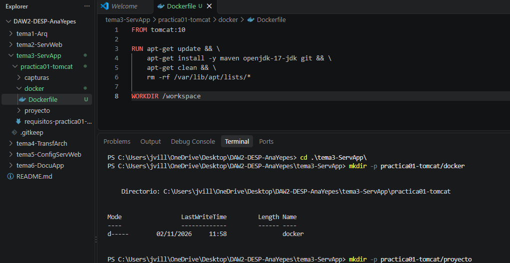
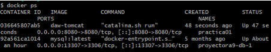
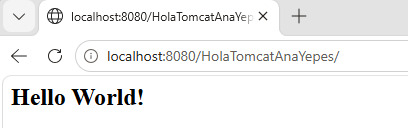
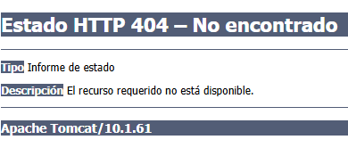

# Práctica 1.

## 1. Objetivo de la práctica:
   
    El objetivo de esta práctica es crear y desplegar una aplicación web Java utilizando Apache Tomcat como servidor de aplicaciones y Docker como entorno de ejecución.
    Para ello se he creado un proyecto Maven, se ha generado un archivo WAR y se ha desplegado en Tomcat dentro de un contenedor Docker.

## 2. Arquitectura implementada:
    **Docker:** proporciona un entorno aislado y reproducible.

    **Tomcat 10:** servidor de aplicaciones encargado de ejecutar la aplicación web.

    **Java 17:** entorno de ejecución de la aplicación.

    **Maven:** herramienta utilizada para compilar y empaquetar el proyecto.

    **Aplicación Java:** aplicación web desarrollada mediante una plantilla Maven.

## 3. Descripción de la solución:
    a) Primero he instalado en VSCode las extensiones: 

      - Extension Pack for Java
      - Maven for Java
      - GitHub Repositories
      - Markdown All in One

    b) Después he configurado Docker, empezando por crear un Dockerfile basado en la imagen oficial tomcat:10.

    La imagen se ha construido utilizando: docker build -t daw-tomcat -f docker/Dockerfile .

    c) He creado el contenedor practica01, conectando el puerto 8080 y compartiendo la carpeta del proyecto, con 
    
    ```bash
    docker run -d --name practica01 -p 8080:8080 -v "${PWD}/proyecto:/workspace" daw-tomcat
    ```

    d) Finalmente he creado el proyecto Maven con el comando: 
    
    ```bash
    mvn archetype:generate \
    -DgroupId=daw.alumno \
    -DartifactId=HolaTomcatAnaYepes \
    -DarchetypeArtifactId=maven-archetype-webapp \
    -DinteractiveMode=false
    ```

    e) Con esto he podido generar el archivo WAR ejecutando mvn compile y mvn package

    g) Y he comprobado que podía desplegar la aplicación en Tomcat, copiando  el archivo WAR al directorio de aplicaciones de Tomcat:
    ```bash
    cp target/HolaTomcatTuNombre.war /usr/local/tomcat/webapps/
    ```

    Tomcat despliega automáticamente la aplicación.

    http://localhost:8080/HolaTomcatAnaYepes/


## 4. Evidencias obtenidas: (capturas de pantalla incluidas en la carpeta capturas para facilitar su visualización)







## 5. Problemas encontrados y soluciones aplicadas: 
   El problema que he encontrado es que cuando he creado y arrancado el contenedor, no me salía la página de bienvenida de Tomcat, sino un error 404.
   Indicaba que Tomcat estaba funcionando pero que no encontraba ninguna aplicación para desplegar.
   La solución ha sido crear el archivo .war, porque no estaba en webapps. Cuando he hecho cp /workspace/HolaTomcatAnaYepes/target/HolaTomcatAnaYepes.war /usr/local/tomcat/webapps/, ya lo ha cogido bien.
   

## 6. Conclusiones: 
   La aplicación se ha desplegado correctamente y se puede acceder a ella mediante el navegador utilizando el puerto 8080.

