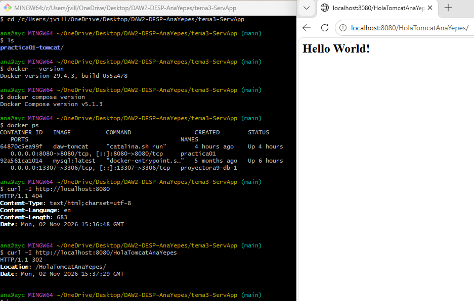
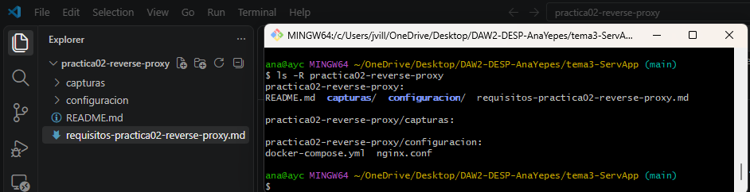
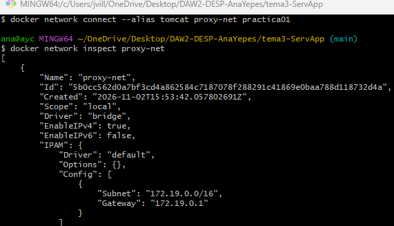
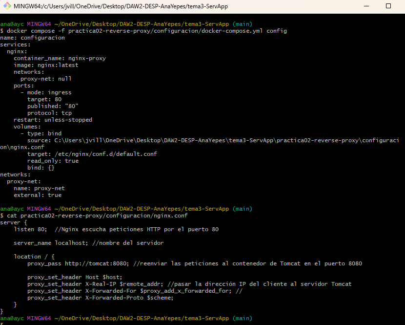
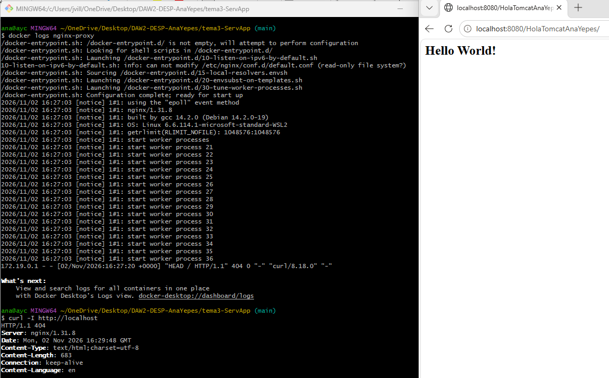
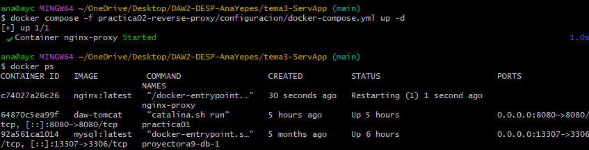
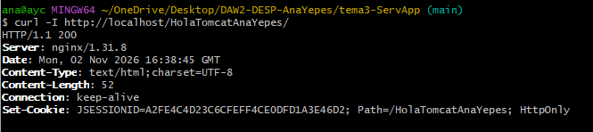
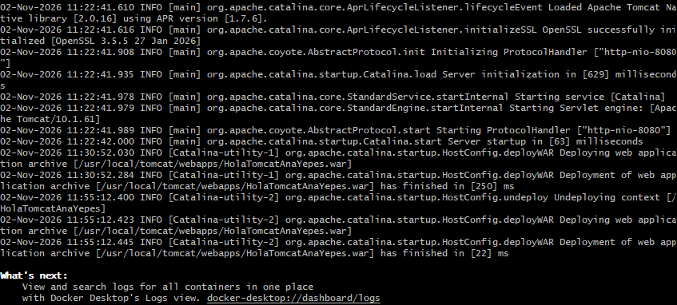

# Práctica 2. 

## 1. Objetivo de la práctica

El objetivo de esta práctica es integrar un servidor web Nginx con un servidor de aplicaciones Tomcat mediante la configuración de un Reverse Proxy.

Se pretende que Nginx actúe como servidor frontal, recibiendo las peticiones HTTP de los usuarios y reenviándolas a Tomcat, donde se encuentra desplegada la aplicación Java.

## 2. Arquitectura implementada

La arquitectura está formada por los siguientes componentes:

- **Cliente:** navegador web desde el que se accede a la aplicación.
- **Nginx:** servidor web frontal que escucha en el puerto 80.
- **Tomcat:** servidor de aplicaciones que escucha en el puerto 8080 dentro de Docker.
- **Aplicación Java:** aplicación web desplegada en Tomcat.
- **Docker:** tecnología utilizada para ejecutar los servicios en contenedores.
- **Red Docker:** red interna `proxy-net`, que permite la comunicación entre Nginx y Tomcat.

El recorrido de las peticiones es el siguiente:

1. El usuario accede a `http://localhost/HolaTomcatAnaYepes`.
2. Nginx recibe la petición en el puerto 80.
3. Nginx actúa como Reverse Proxy y reenvía la petición a Tomcat.
4. Tomcat procesa la solicitud y ejecuta la aplicación Java.
5. La respuesta vuelve a Nginx.
6. Nginx devuelve la respuesta al navegador.

## 3. Desarrollo de la práctica

### Tarea 1. Verificación del entorno

Primero comprobamos que Docker Desktop estaba funcionando y que el contenedor Tomcat de la práctica anterior permanecía activo.

También  que la aplicación Java era accesible directamente mediante Tomcat.

Comandos utilizados:

```bash
docker --version
docker ps
docker ps -a
curl -I http://localhost:8080
```

### Tarea 2. Preparación de la estructura

Creo la carpeta `practica02-reverse-proxy` con los directorios `capturas` y `configuracion`.

Dentro de configuración, van los archivos `docker-compose.yml` y `nginx.conf`.

### Tarea 3. Configuración de Nginx
Como ya tengo Tomcat de la práctica anterior, reutilizo el contenedor practica 01.

Hago una red Docker llamada `proxy-net` para permitir la comunicación entre los dos contenedores.

```bash
docker network create proxy-net
```

Y conecto el contenedor Tomcat a esta red utilizando el alias `tomcat`.

### Tarea 4. Despliegue de Nginx
He utilizado la imagen oficial de Nginx mediante Docker.

En el archivo `nginx.conf` configuro un servidor que escucha en el puerto 80 y reenvía las peticiones al servidor Tomcat.

```nginx
proxy_pass http://tomcat:8080;
```
A tener en cuenta: 

• listen80: Nginx escucha peticiones HTTP por el puerto 80
• proxy_pass: Reenvía las peticiones recibidas al puerto 8080 de Tomcat.
• location / : Procesa las peticiones recibidas en cualquier ruta.

También he configurado las cabeceras HTTP para conservar información de la petición original, como la dirección IP del cliente y el protocolo utilizado.

Ahora creo el Docker Compose para iniciar el contenedor Nginx y conectarlo a la red Docker compartida.

```bash
docker compose -f practica02-reverse-proxy/configuracion/docker-compose.yml up -d
```
A tener en cuenta:
•	image: nginx:latest: utiliza la imagen oficial de Nginx.
•	container_name: establece el nombre del contenedor.
•	ports: publica el puerto 80 del contenedor en el puerto 80 de nuestro ordenador.
•	volumes: incorpora nuestro archivo de configuración al contenedor.
•	networks: conecta Nginx a la red compartida con Tomcat.
•	external: true: indica que utilizaremos la red que hemos creado anteriormente.
•	restart: permite reiniciar automáticamente el contenedor si se detiene.
Importante: el archivo nginx.conf está en la misma carpeta que docker-compose.yml. Por eso podemos utilizar ./nginx.conf.


Compruebo que los dos contenedores estaban funcionando mediante:

```bash
docker ps
```

### Tarea 5. Verificación del Reverse Proxy

Accedo desde el navegador utilizando: `http://localhost/HolaTomcatAnaYepes`

Siendo Nginx el servidor que recibe inicialmente la petición y Tomcat el encargado de ejecutar la aplicación Java.

También compruebo mediante:

```bash
curl -I http://localhost
docker logs nginx-proxy
docker logs practica01
```

### Tareas 6 y 7. Análisis del tráfico y registros

Consulto los registros de Nginx y Tomcat para comprobar el funcionamiento de ambos servicios.

Para Nginx:

```bash
docker logs nginx-proxy
```

Para Tomcat:

```bash
docker logs practica01
```

Estos registros permiten analizar el funcionamiento de los servidores y detectar posibles errores.

El recorrido de una petición desde el navgador hasta la aplicación es el siguiente: 
Una petición comienza cuando el usuario accede desde el navegador a la aplicación mediante http://localhost/HolaTomcatAnaYepes.
Nginx recibe la petición por el puerto 80 y la reenvía a Tomcat a través de la red interna de Docker (proxy-net), utilizando el puerto 8080. 
Tomcat procesa la petición y devuelve la respuesta a Nginx, que finalmente la envía al navegador del usuario.

### Tarea 8. Seguridad de la arquitectura
1.	¿Por qué se utiliza un servidor web frontal?
Para centralizar las peticiones y que haga de intermediario entre internet y el servidor de aplicaciones. Así controlamos el acceso y gestionamos las conexiones.

2.	¿Qué ventajas aporta un Reverse Proxy?

-	Ocultar la dirección y los detalles internos del servidor de aplicaciones
-	Centralizar las peticiones HTTP.
-	Facilitar la configuración de HTTPS.
-	Distribuir el tráfico entre varios servidores.
-	Aplicar medidas de seguridad y filtrado.
-	Mejorar el rendimiento mediante caché y compresión, cuando se configura.

3.	¿Qué problemas podrían surgir si Tomcat fuese accesible directamente por todos los usuarios?
Estaría más expuesto a ataques, ya que daría acceso directo a servicios y puertos internos y expondría la infraestructura.
En un entorno real, sería recomendable permitir el acceso público únicamente a Nginx y mantener Tomcat accesible solamente desde la red interna.


## 4. Configuración utilizada

Los archivos principales de la práctica son:

- `configuracion/nginx.conf`: contiene la configuración del servidor web y del Reverse Proxy.
- `configuracion/docker-compose.yml`: define el despliegue del contenedor Nginx y su conexión a la red Docker.

## 5. Evidencias obtenidas

Las capturas de pantalla se encuentran en la carpeta `capturas`.

- Verificacion del entorno
 
 -Estructura
 
 -Comprobacion Nginx
 
 - Comprobacion Nginx y Docker compose
 
 - Aplicación y contenedores funcionando
  
  
  - Logs Nginx
  
  - Logs Tomcat
  

## 6. Problemas encontrados y soluciones aplicadas

Uno de los problemas que he encontrado es que en nginx.conf quería poner comentarios y no sabía que era con # en lugar de //. 
Me daba un error en la sintaxis, que solo he tenido que corregir en el texto.
Otro problema era que al hacer  curl -I http://localhost:8080 me salia HTTP/1.1 404, porque Tomcat no encontraba la aplicación en esa ruta.
Lo he solucionado comprobando las aplicaciones que tenía desplegadas en webapps, para ver qué nombre tenían. He localizado HolaTomcatAnaYepes y he accedido a ella poniendo /HolaTomcatAnaYepes en lugar de la ruta raíz.

## 7. Cuestiones finales

### 1. ¿Qué diferencia existe entre un servidor web y un servidor de aplicaciones?

El servidor web se encarga de recibir peticiones HTTP y servir contenido web. El servidor de aplicaciones proporciona el entorno necesario para ejecutar aplicaciones y procesar su lógica de negocio.

Nginx es un servidor web y Tomcat es un servidor de aplicaciones Java.

### 2. ¿Qué función realiza el Reverse Proxy?

El Reverse Proxy recibe las peticiones de los clientes y las reenvía a otro servidor interno. Después devuelve al cliente la respuesta obtenida. 
Como cuando queremos hacer que una peticion HTTP vaya por HTTPS.

### 3. ¿Por qué se utiliza Nginx delante de Tomcat?

Se utiliza para centralizar el acceso a la aplicación, gestionar las peticiones HTTP y añadir una capa adicional de seguridad entre los usuarios y el servidor de aplicaciones.

### 4. ¿Cuáles son las principales ventajas de esta arquitectura?

Las principales ventajas son la separación de responsabilidades, la centralización del tráfico, la mejora de la seguridad, la posibilidad de implementar HTTPS y la capacidad de distribuir las peticiones entre varios servidores.

### 5. ¿Qué mejoras podrían añadirse en un entorno real?

Se podrían incorporar certificados SSL/TLS para habilitar HTTPS.
También posibilitar el balanceo de carga entre varios servidores y automatizar la monitorización del tráfico y los logs.
Por último añadir reglas de seguridad para evitar estar tan expuestos a ataques.

## 8. Conclusiones

Con esta práctica integramos Nginx y Tomcat mediante Docker, utilizando Nginx como servidor web frontal y Tomcat como servidor de aplicaciones.

La configuración del Reverse Proxy permite que los usuarios accedan a la aplicación Java a través del puerto 80, sin necesidad de acceder directamente al puerto de Tomcat.

Además, hemos habilitado la comunicación entre los contenedores mediante una red Docker compartida y analizado los registros de ambos servidores.

