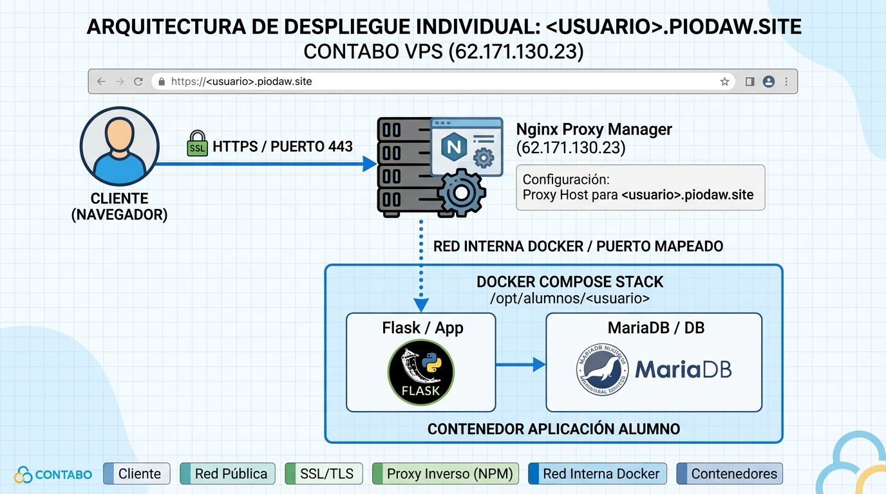

# Práctica 07 

## ⏳ TimeFlies — cápsulas del tiempo

| Parámetro | Valor |
| --- | --- |
| Usuario del VPS | `anayepes` |
| URL pública | https://anayepes.piodaw.site |
| Puerto host asignado | `8002` |
| Ruta en el servidor | `/opt/alumnos/anayepes/practica07-produccion` |

**TimeFlies** es una aplicación web para escribir **cartas a tu yo del futuro**. Cada carta se guarda en MariaDB como una
*cápsula sellada*: nadie puede leerla hasta la fecha de apertura que elija su autor. Cuando llega ese día, la cápsula se
abre, se puede descargar en PDF y, aparece en el muro público de la portada (si se ha marcado la casilla para mostrar).

---

## 1. Introducción

El objetivo de la práctica es desplegar una aplicación web en un **entorno de producción permanente** (VPS de Contabo),
administrándolo por **SSH**, ejecutando la aplicación con **Docker Compose** y publicándola con **HTTPS** mediante
**Nginx Proxy Manager**.

La aplicación parte de la estructura de la práctica 05 (Nginx + Flask + MariaDB), pero es una aplicación nueva y propia
que aplica el patrón **MVC**: muestra páginas web (Vista), procesa las peticiones con Flask (Controlador) y guarda y
muestra los datos en MariaDB (Modelo).

---

## 2. Infraestructura

| Parámetro | Valor |
| --- | --- |
| Servidor / Proveedor | VPS Contabo |
| IP pública del VPS | `62.171.130.23` |
| Dominio base | `piodaw.site` |
| Subdominio | `anayepes.piodaw.site` |
| Ruta del workspace | `/opt/alumnos/anayepes` |
| Nginx Proxy Manager | `http://62.171.130.23:81` |
| Portainer | `https://62.171.130.23:9443` |

---

## 3. Arquitectura



**Recorrido de una petición:**

1. El navegador pide `https://anayepes.piodaw.site` (HTTPS, puerto 443).
2. **Nginx Proxy Manager** termina el HTTPS con el certificado de **Let's Encrypt** y reenvía la petición por HTTP al
   puerto asignado **8002** del VPS.
3. El contenedor **`anayepes_nginx`** (servidor web) recibe la petición y la pasa con `proxy_pass` a **`flask:5000`**.
4. **Gunicorn** (servidor de aplicaciones) ejecuta la aplicación **Flask**, que consulta **MariaDB** por la red interna
   de Docker y devuelve el HTML generado.


**Tecnologías:**

| Tecnología | Uso |
| --- | --- |
| Python 3.12 + Flask 3 | Controladores (rutas) |
| Jinja2 | Vistas (plantillas HTML) |
| PyMySQL | Modelos (consultas SQL a MariaDB) |
| MariaDB 11 | Base de datos |
| Gunicorn | Servidor de aplicaciones WSGI de producción |
| Nginx | Servidor web y proxy inverso |
| Flask-WTF | Protección CSRF de los formularios |
| fpdf2 | Generación de PDF |
| HTML, CSS y JavaScript | Interfaz, diseño responsive y cuenta atrás |
| Docker Compose | Orquestación de los 3 contenedores |

---

## 4. Despliegue en producción

### Tarea 1. Conexión SSH al VPS

Me conecto con mi usuario asignado (no con `root`), cambio la contraseña inicial y compruebo mi identidad y mis grupos:

```bash
ssh anayepes@62.171.130.23
passwd          # solo la primera vez
whoami          # -> anayepes
id              # comprobar que pertenezco al grupo daw
```

### Tarea 2. Directorio de trabajo

```bash
cd /opt/alumnos/anayepes
pwd
ls -la
```
### Tarea 3. Transferir el proyecto al VPS

Desde Git Bash en mi PC, en la carpeta del repositorio, copio el proyecto con `scp` (copia segura por SSH):

```bash
scp -r ./practica07-produccion anayepes@62.171.130.23:/opt/alumnos/anayepes/
ssh anayepes@62.171.130.23 "chmod -R u+rwX,g+rwX /opt/alumnos/anayepes/practica07-produccion"
```

El `chmod` corrige los permisos que `scp` copia desde Windows.
El archivo `.env` con las contraseñas también se copia: el `docker compose` del servidor lo necesita, aunque no está en GitHub.


### Tarea 4. Configurar `docker-compose.yml`

Decisiones para convivir con los demás alumnos en el mismo VPS:

| Configuración | Motivo |
| --- | --- |
| `ports: "8002:80"` en nginx | Puerto del host asignado a `anayepes`. Nginx Proxy Manager reenvía el subdominio a este puerto |
| `name: anayepes-p07` | Todos tenemos una carpeta `practica07-produccion`; con un nombre de proyecto propio, las redes y volúmenes no coinciden con los de otro alumno |
| `container_name: anayepes_...` | Los nombres de contenedor son únicos en todo el servidor |
| `MARIADB_USER: timeflies` | La aplicación usa un usuario propio con permisos solo sobre su base de datos, no `root` |
| `${DB_PASSWORD}`, `${SECRET_KEY}` | Las contraseñas se leen del archivo `.env`, que no se sube a GitHub |
| Volumen `timeflies_data` | Los datos de MariaDB persisten aunque se recreen los contenedores |
| `TZ: Europe/Madrid` | Hora española para las fechas de apertura |


### Tarea 5. Publicación de la aplicación

El servidor tiene una tarea **cron** que reconstruye y levanta los contenedores a las **08:00, 14:00 y 20:00**.
No ejecuto `docker compose` en el servidor: subo los archivos y espero a la siguiente ventana de despliegue.
Después compruebo desde el propio VPS que la aplicación responde y que Flask conecta con MariaDB:

```bash
curl -I http://localhost:8002          # HTTP/1.1 200 OK
curl -s http://localhost:8002/salud    # {"app":"TimeFlies","estado":"ok","mariadb":"11...."}
```


### Tarea 6. Nginx Proxy Manager

El *proxy host* `anayepes.piodaw.site → 62.171.130.23:8002`, con certificado SSL de Let's Encrypt, ya estaba configurado
por el profesor. Solo he comprobado que el subdominio funciona.

### Tarea 7. Verificación final en el navegador

1. **El candado HTTPS está activo y el certificado es válido**, expedido por Let's Encrypt:
2. **La aplicación carga correctamente** (captura 05).
3. **La aplicación conecta con MariaDB y guarda los cambios:** en la captura 05 la portada muestra 3 cápsulas abiertas.
   Tras registrarme, crear una cápsula pública y abrirla desde la aplicación, la portada muestra **4 cápsulas abiertas**
   y la nueva carta aparece la primera en el muro. El dato se ha guardado en MariaDB y se lee de ella:


---

## 5. Tarea 8: la aplicación TimeFlies

### 5.1 Funcionalidades

| Funcionalidad | Descripción |
| --- | --- |
| Portada | Contadores (cápsulas enviadas, selladas y abiertas) y muro de cápsulas públicas ya abiertas |
| Registro e inicio de sesión | Cuentas con email y contraseña (guardada con *hash*), cierre de sesión |
| Nueva cápsula | Título, emoción, mensaje, fecha de apertura y opción de compartirla en el muro |
| Mis cápsulas | Lista de las cápsulas del usuario con su estado y una **cuenta atrás** en directo (JavaScript) |
| Abrir cápsula | Solo cuando llega su fecha; el mensaje no se envía al navegador mientras está sellada |
| Eliminar cápsula | Con confirmación |
| PDF | Certificado de sellado (sin el mensaje) o carta completa si ya está abierta |
| `/salud` | Comprobación técnica en JSON: Flask funciona y conecta con MariaDB |

### 5.2 Estructura MVC

```text
app/
├── app.py                  # Punto de entrada: crea la app, activa CSRF y registra los controladores
├── db.py                   # Conexión a MariaDB y funciones consultar / consultar_uno / ejecutar
├── models/                 # MODELO: todo el SQL
│   ├── usuario.py          #   buscar, crear y comprobar contraseña
│   └── capsula.py          #   muro, contadores, crear, listar, abrir, borrar
├── controllers/            # CONTROLADOR: rutas (un Blueprint por sección)
│   ├── main.py             #   portada y /salud
│   ├── auth.py             #   registro, login, logout y decorador @login_requerido
│   └── capsulas.py         #   cápsulas y PDF
├── services/
│   └── pdf.py              # Generación del PDF (fpdf2)
├── templates/              # VISTA: plantillas Jinja2 (heredan de base.html)
│   ├── base.html  ·  index.html
│   ├── auth/      login.html · registro.html
│   └── capsulas/  lista.html · nueva.html · ver.html
└── static/                 # VISTA: css/estilos.css y js/app.js
```

**Ejemplo del flujo MVC al abrir la portada:** el controlador `main.inicio()` pide los datos al modelo
(`capsula.muro()` y `capsula.contadores()`), que ejecuta el SQL en MariaDB, y se los pasa a la vista `index.html`, que
genera el HTML.

### 5.3 Base de datos

Dos tablas relacionadas por una **clave foránea** (cada cápsula pertenece a un usuario):

| Tabla | Campos principales |
| --- | --- |
| `usuarios` | `id`, `nombre`, `email` (único), `password_hash`, `creado_en` |
| `capsulas` | `id`, `usuario_id` (FK → usuarios), `titulo`, `mensaje`, `emocion`, `fecha_apertura`, `publica`, `abierta`, `abierta_en`, `creado_en` |

`database/schema.sql` crea las tablas y `database/datos.sql` inserta datos de ejemplo. MariaDB los ejecuta
automáticamente la primera vez que arranca con el volumen vacío (`/docker-entrypoint-initdb.d/`).


### 5.4 Seguridad

- **HTTPS** con certificado de Let's Encrypt en Nginx Proxy Manager.
- **Contraseñas con hash** (`generate_password_hash` / `check_password_hash` de Werkzeug): nunca se guardan en claro.
- **Protección CSRF** con Flask-WTF: todos los formularios POST llevan un token secreto.
- **Consultas SQL parametrizadas** (`%s`): evitan la inyección SQL.
- **Escape automático de Jinja2**: evita ataques XSS.
- **Control de acceso por usuario en el SQL** (`WHERE id = %s AND usuario_id = %s`): una cápsula ajena devuelve 404.
- **El mensaje sellado no sale del servidor** y la base de datos no permite abrir una cápsula antes de su fecha
  (`fecha_apertura <= NOW()`).
- **`@login_requerido`** protege las páginas privadas y comprueba que el usuario de la sesión existe en la BBDD.
- **Secretos fuera del código:** contraseñas y `SECRET_KEY` en `.env` (incluido en `.gitignore`).
- **MariaDB sin puertos publicados** y con un usuario propio en lugar de `root`.
- **Nginx** oculta su versión (`server_tokens off`) y añade cabeceras de seguridad.

### 5.5 Desarrollo y pruebas en local

Antes de subir cada cambio lo pruebo en mi PC con Docker Desktop:

```bash
cd practica07-produccion
cp .env.example .env            # y rellenar las contraseñas
docker compose up -d --build
# abrir http://localhost:8002
```


## 6. Actualizar la aplicación en producción

Para publicar un cambio:

1. Lo pruebo en local con `docker compose up -d --build`.
2. Hago commit y lo subo a GitHub.
3. Copio el proyecto al VPS y corrijo los permisos:
   ```bash
   scp -r ./practica07-produccion anayepes@62.171.130.23:/opt/alumnos/anayepes/
   ssh anayepes@62.171.130.23 "chmod -R u+rwX,g+rwX /opt/alumnos/anayepes/practica07-produccion"
   ```
4. Espero a la siguiente ventana de despliegue (08:00, 14:00 o 20:00).

Al redesplegar se recrean los contenedores, pero los datos siguen en el volumen `timeflies_data`. La cuenta y la
cápsula creadas antes del redespliegue siguen existiendo después.


---

## 7. Cuestionario de reflexión (Tarea 9)

**1. Gestión de usuarios y permisos: ¿por qué trabajo dentro de `/opt/alumnos/anayepes` con mi propio usuario en lugar de usar `root`?**

Por el **principio de mínimo privilegio**: cada usuario debe tener solo los permisos que necesita. Con mi usuario solo
puedo modificar mi carpeta, así que un error (un `rm` mal escrito, sobrescribir un archivo) o una contraseña robada no
afectan al sistema ni al trabajo de mis compañeros. `root` tiene control total sobre un servidor que compartimos 16
alumnos. Además, cada acción queda asociada a un usuario concreto (trazabilidad), y el profesor controla el acceso con
grupos (`daw`) y permisos (ACL).

**2. Puertos y proxy inverso: ¿cuál es la función de Nginx Proxy Manager y por qué no exponemos la aplicación directamente en el puerto 80?**

Nginx Proxy Manager es el **proxy inverso** de entrada del VPS: recibe todas las peticiones en los puertos 80 y 443,
**termina el HTTPS** con certificados de Let's Encrypt (que renueva automáticamente) y, según el subdominio
(`anayepes.piodaw.site`), las reenvía al puerto interno de cada alumno (`8002`). El puerto 80 solo puede usarlo un
proceso a la vez. Si mi contenedor lo ocupara, ningún compañero podría publicar su web, y además mi aplicación iría sin
cifrar. Con NPM hay un único punto de entrada, el HTTPS está centralizado y cada aplicación queda aislada en su puerto.

**3. Persistencia: si ejecuto `docker compose down` y luego `docker compose up -d`, ¿se pierden los datos de MariaDB?**

**No.** Los datos están en el **volumen** `timeflies_data`, montado en `/var/lib/mysql`. `docker compose down` elimina
los contenedores y la red, pero **no los volúmenes**. Al volver a levantar, el nuevo contenedor de MariaDB monta el mismo
volumen y encuentra los datos intactos. Como el volumen no está vacío, tampoco vuelve a ejecutar `schema.sql` ni
`datos.sql`. Solo se perderían con `docker compose down -v` (que también borra los volúmenes) o con `docker volume rm`.
Lo he comprobado en la práctica: en local uso `down -v` precisamente para reiniciar la base de datos, y en producción los
datos sobreviven a cada redespliegue del cron (captura 15).

---

## 8. Estructura del repositorio

```text
practica07-produccion/
├── README.md               # Esta memoria
├── docker-compose.yml      # 3 servicios: mariadb, flask y nginx
├── .env.example            # Plantilla de variables (el .env real no se sube)
├── .gitignore
├── app/
│   ├── app.py
│   ├── db.py
│   ├── requirements.txt
│   ├── Dockerfile
│   ├── models/
│   ├── controllers/
│   ├── services/
│   ├── templates/
│   └── static/
├── database/
│   ├── schema.sql
│   └── datos.sql
├── nginx/
│   └── nginx.conf
├── capturas/               # 01 a 16
└── docs/
    ├── arquitectura-pract07.png
    └── arquitectura-pract07.jpg
```

---

## 9. Problemas encontrados y soluciones

| Problema | Causa | Solución |
| --- | --- | --- |
| Tras el `scp`, la carpeta quedó con permisos `dr-x------` | `scp` copia los permisos de Windows, que no se traducen bien a Linux. Sin permisos de grupo, la máscara de las ACL también anulaba el acceso del sistema de despliegue | `chmod -R u+rwX,g+rwX` después de cada `scp` |
| La consulta a la tabla `capsulas` salía vacía | La consulta se lanzó antes de que MariaDB terminara de ejecutar los scripts de inicio | Revisar los logs (`docker compose logs mariadb`) y repetir la consulta |
| `NameError` y vista que devolvía `None` | Faltaban `import` y la sangría de un `return` quedó desplazada al pegar el código | Revisar los `import` de cada archivo y la indentación (en Python la sangría define los bloques) |

---