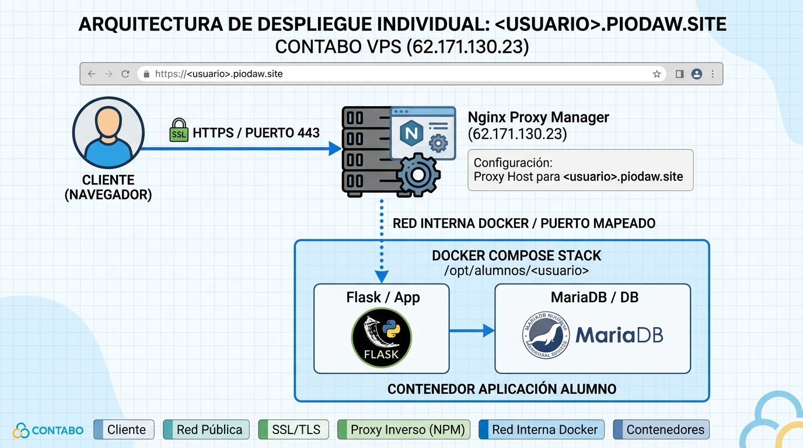
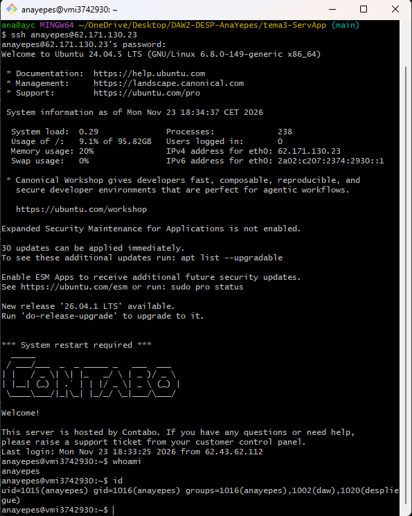
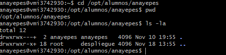
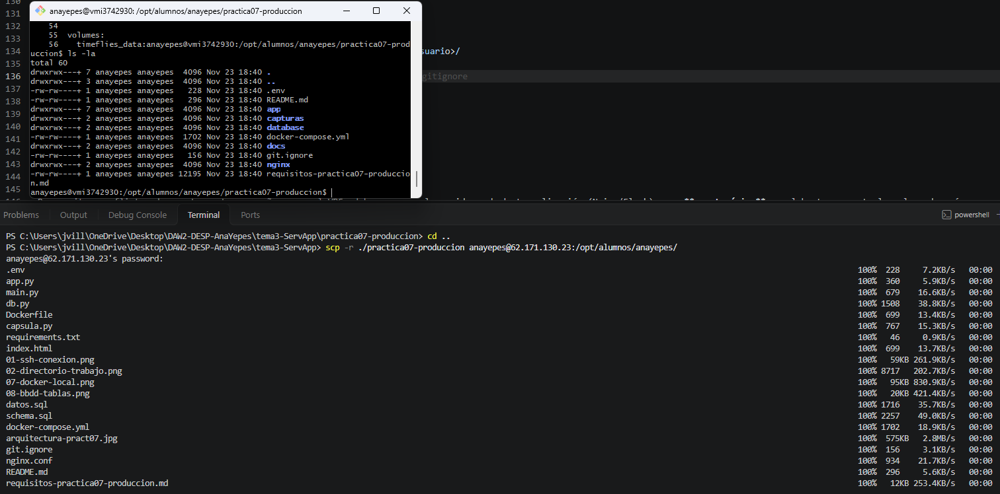
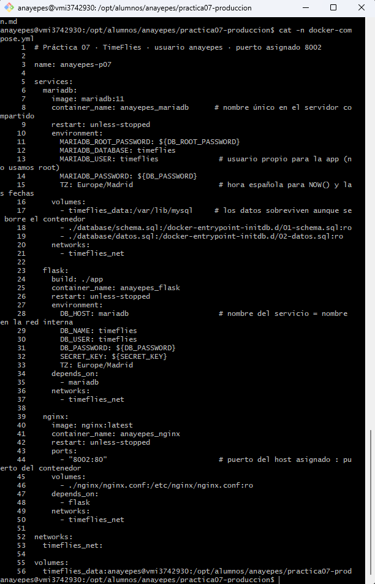
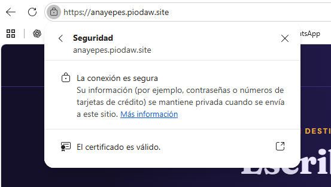
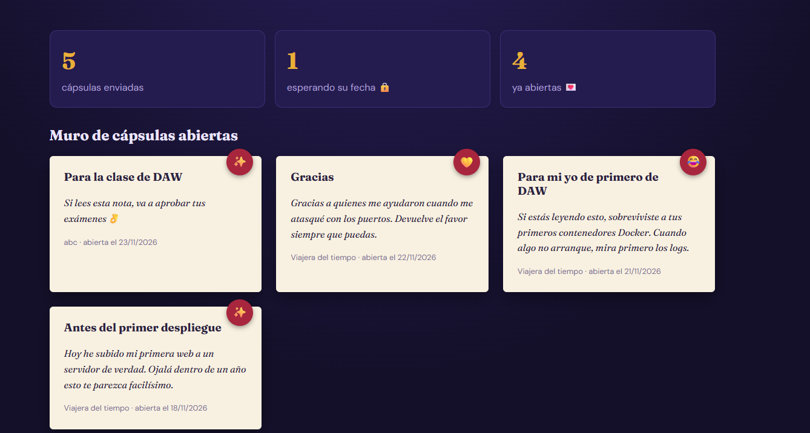

# Práctica 07. Despliegue en VPS Contabo (Entorno de Producción)

## Resultado de aprendizaje

Desplegar una aplicación web en un entorno de producción permanente utilizando un VPS en Contabo (`piodaw.site`), aplicando procedimientos de administración remota SSH, ejecución de contenedores Docker Compose y publicación mediante Nginx Proxy Manager con HTTPS.
Se utilizará la estructura base de la practica05-compose-mariadb 
pero debe ser una aplicación diferenciada del resto de alumnos y que aplique el MVC, mostrar página web, procesar con flask-python y almacenar-mostrar de BBDD mariaDB

---

# Criterios de evaluación

- c) Configurar la cooperación entre el servidor web y el servidor de aplicaciones.
- d) Configurar los mecanismos necesarios para asegurar las aplicaciones web.
- e) Configurar y utilizar los componentes web del entorno de ejecución.
- f) Realizar el despliegue de aplicaciones web.
- h) Elaborar documentación relativa a la administración y uso de las aplicaciones desplegadas.
- i) Utilizar tecnologías de virtualización, contenedores y nube.

---

# Información de Infraestructura

El servidor ya se encuentra previamente aprovisionado y configurado con los siguientes datos:

| Parámetro | Valor |
| --- | --- |
| **Servidor / Proveedor** | VPS Contabo |
| **IP Pública VPS** | `62.171.130.23` |
| **Dominio Base** | `piodaw.site` |
| **Subdominio Alumno** | `<usuario>.piodaw.site` |
| **Ruta del workspace** | `/opt/alumnos/<usuario>` |
| **Nginx Proxy Manager** | `http://62.171.130.23:81` |
| **Portainer** | `https://62.171.130.23:9443` |

---

# Arquitectura objetivo

```text
Cliente (Navegador)
       │
       ▼ (HTTPS / 443)
https://<usuario>.piodaw.site
       │
       ▼
Nginx Proxy Manager (Contabo VPS - 62.171.130.23)
       │
       ▼ (Red interna / Puerto mapeado)
Contenedor Aplicación Alumno (/opt/alumnos/<usuario>)
       │
  ┌────┴────────────┐
  ▼                 ▼
Flask / App      MariaDB / DB
```
```text
docs/arquitectura-pract07.jpg
```




---

# TAREA 1. Conexión SSH al VPS

Cada alumno utilizará su cuenta asignada (ejemplo: `ivanaguilar6`, `kelmycanales`, `josesanz14`, etc.).

## Paso 1. Conectarse por SSH

Abrir la terminal local y conectarse al servidor con su usuario asignado, en mi caso
el usuario para la práctica es juangarcia317:

```bash
ssh <usuario>@62.171.130.23
```

*Nota: Si configuraste tu clave SSH en el servidor, accederás directamente sin contraseña.*
Si no tendrás que introducir la contraseña proporcionada por el profesor y justo después
cambiarla con el comando
```bash
passwd
```

### Captura obligatoria
```text
capturas/01-ssh-conexion.png
```


---

## Paso 2. Verificar permisos e identidad

Ejecutar en el servidor:

```bash
whoami
id
```

Verificar que perteneces a los grupos `daw` .

---

# TAREA 2. Acceder al directorio de trabajo

Cada alumno dispone de un directorio exclusivo con permisos preconfigurados en `/opt/alumnos/<usuario>`.

## Paso 1. Entrar en la carpeta personal

```bash
cd /opt/alumnos/<usuario>
pwd
```

### Captura obligatoria
```text
capturas/02-directorio-trabajo.png
```


---

# TAREA 3. Transferir el proyecto al VPS

Utilizar como base la aplicación desarrollada en la **Práctica 05**.

## Mediante SCP (desde tu máquina local)

En tu equipo local, comprime el proyecto y transférelo:

```bash
scp -r ./practica05-compose-mariadb <usuario>@62.171.130.23:/opt/alumnos/<usuario>/
```
### Captura obligatoria
```text
capturas/03-transferencia-proyecto.png
```


---

# TAREA 4. Configurar `docker-compose.yml`

Para evitar conflictos de puertos entre compañeros en el VPS, debes mapear el servidor web de tu aplicación (Nginx/Flask) a un **puerto único** en el host o conectarlo a la red común.

## Paso 1. Modificar el archivo `docker-compose.yml`

Asegúrate de asignar un puerto exclusivo para el host (por ejemplo, basado en tu número de lista o rango asignado, como `8001`, `8002`, `8015`, etc.):

### Asignación de Puertos del Host por Alumno

Para evitar conflictos de puertos en el VPS, cada alumno debe mapear el puerto de su servidor web en su archivo `docker-compose.yml` utilizando el puerto del host que tiene asignado en la siguiente tabla (ejemplo: `8015:80`):

| # | Usuario Alumno | Puerto Host Asignado | Ejemplo Mapeo Ports en `docker-compose.yml` | Subdominio Público |
|---|---|---|---|---|
| 1 | `andreajimenez22` | **8001** | `"8001:80"` | `andreajimenez22.piodaw.site` |
| 2 | `anayepes` | **8002** | `"8002:80"` | `anayepes.piodaw.site` |
| 3 | `garypaladines` | **8003** | `"8003:80"` | `garypaladines.piodaw.site` |
| 4 | `ivanaguilar6` | **8004** | `"8004:80"` | `ivanaguilar6.piodaw.site` |
| 5 | `javierportela1` | **8005** | `"8005:80"` | `javierportela1.piodaw.site` |
| 6 | `jfjl04` | **8006** | `"8006:80"` | `jfjl04.piodaw.site` |
| 7 | `jmrb61` | **8007** | `"8007:80"` | `jmrb61.piodaw.site` |
| 8 | `josesanz14` | **8008** | `"8008:80"` | `josesanz14.piodaw.site` |
| 9 | `juanfontiveros` | **8009** | `"8009:80"` | `juanfontiveros.piodaw.site` |
| 10 | `juangarcia317` | **8010** | `"8010:80"` | `juangarcia317.piodaw.site` |
| 11 | `kelmycanales` | **8011** | `"8011:80"` | `kelmycanales.piodaw.site` |
| 12 | `lsv003` | **8012** | `"8012:80"` | `lsv003.piodaw.site` |
| 13 | `luciamoneo` | **8013** | `"8013:80"` | `luciamoneo.piodaw.site` |
| 14 | `rodrigomoreno4` | **8014** | `"8014:80"` | `rodrigomoreno4.piodaw.site` |
| 15 | `rouyanye` | **8015** | `"8015:80"` | `rouyanye.piodaw.site` |
| 16 | `rubencollado` | **8016** | `"8016:80"` | `rubencollado.piodaw.site` |


```yaml
 services:
  mariadb:
    image: mariadb:11
    container_name: mariadb
    restart: unless-stopped
    environment:
      MYSQL_ROOT_PASSWORD: XXXX # password de root de BBDD de la practica05    
      MYSQL_DATABASE: practica05juanprofe # pon aquí el nombre de tu base de datos de la practica05    
    volumes:
      - mariadb_data:/var/lib/mysql
      - ./database/schema.sql:/docker-entrypoint-initdb.d/01-schema.sql
      - ./database/datos.sql:/docker-entrypoint-initdb.d/02-datos.sql
    networks:
      - practica05_net
  flask:
    build: ./app
    container_name: flask
    restart: unless-stopped
    environment:
      DB_HOST: mariadb
      DB_USER: root
      DB_PASSWORD: XXXX # password de root de BBDD de la practica05  
      DB_NAME: practica05juanprofe # pon aquí el nombre de tu base de datos de la practica05    
    depends_on:
      - mariadb
    networks:
      - practica05_net
  nginx:
    image: nginx:latest
    container_name: nginx
    restart: unless-stopped
    ports:
      - "8010:80" #AQUÍ VA TU PUERTO ASIGNADO, el mío es 8010
    volumes:
      - ./nginx/nginx.conf:/etc/nginx/nginx.conf:ro
    depends_on:
      - flask
    networks:
      - practica05_net
networks:
  practica05_net:
volumes:
  mariadb_data:
```

### Captura obligatoria
```text
capturas/04-docker-compose-yml.png
```


---
## TAREA 5. Publicación de la aplicación

### Entorno de producción controlado

En entornos profesionales no siempre se despliegan los cambios inmediatamente después de ser desarrollados.

Con frecuencia se establecen ventanas de despliegue programadas para garantizar la estabilidad de los servicios y reducir el riesgo de incidencias en producción.

Para simular este escenario real de operación, el servidor dispone de una tarea programada mediante:

```text
cron
```
que ejecuta automáticamente el proceso de despliegue varias veces al día.

Horarios de despliegue:

```text
08:00

14:00

20:00
```

Durante cada ejecución:

```text
1. Se reconstruyen los contenedores necesarios.

2. Se reinician los servicios Docker Compose.

3. Las aplicaciones quedan publicadas automáticamente.
```

---

### Trabajo del alumno

Una vez transferido el proyecto a:

```text
/opt/alumnos/<usuario>/practica07-produccion
```

no será necesario ejecutar:

```bash
docker compose up -d

docker compose down

docker compose restart
```

Estas tareas serán realizadas automáticamente por el servidor.

El alumno únicamente deberá:

```text
Modificar su aplicación.

Actualizar los archivos necesarios.

Esperar a la siguiente ventana de despliegue.
```

---

### Comprobación

Tras la siguiente ejecución programada, comprobar que la aplicación se encuentra disponible en:

```text
https://<usuario>.piodaw.site
```

### Captura obligatoria

```text
capturas/05-aplicacion-funcionando-https.png
```



---

### Verificación

Comprobar que:

- La aplicación responde correctamente.
- Los cambios realizados aparecen reflejados.
- La conexión con MariaDB sigue funcionando.
- No existen errores visibles en el navegador.

---

# TAREA 6. Publicar en Nginx Proxy Manager (NPM)

Una vez que tu contenedor está funcionando en la IP local y puerto elegido (ej. `62.171.130.23:80XX`), se debe publicar bajo tu subdominio con certificado SSL en el panel de Nginx Proxy Manager. Esa parte ya está realizada por lo que simplemente debes abrir tu página y ver los resultados.
 
 
---

# TAREA 7. Verificación final en el navegador

Abrir un navegador e ingresar a la URL pública de tu aplicación:

```text
https://<usuario>.piodaw.site
```

Verificar:
1. El candado de HTTPS está activo y es válido.
2. La aplicación web carga correctamente.
3. La aplicación conecta correctamente con la base de datos MariaDB.

Realiza algún cambio en la aplicación de forma que se vea que ha guardado en la base de datos y se visualiza el valor cambiado.

### Captura obligatoria
```text
capturas/06-aplicacion-funcionando-https.png
```


---
# TAREA 8. Mejora de la web en Contabo
Ya hemos subido la aplicación base a producción,  pero ahora genera una aplicación mejorada que cubra las 3 partes del MVC.


# TAREA 9. Cuestionario de Reflexión de Producción

Responde en tu entrega a las siguientes preguntas:

1. **Gestión de Usuarios y Permisos:** ¿Por qué trabajas dentro de `/opt/alumnos/<usuario>` con tu propio usuario en lugar de usar `root` directamente?
2. **Puertos y Proxy Inverso:** ¿Cuál es la función de Nginx Proxy Manager en esta arquitectura y por qué no exponemos la aplicación directamente en el puerto 80 al exterior?
3. **Persistencia:** Si ejecutas `docker compose down` y luego `docker compose up -d`, ¿se pierden los datos almacenados en MariaDB? Explica por qué.

---

# Estructura obligatoria del repositorio a entregar

```text
practica07-produccion/
│
├── README.md
├── docker-compose.yml
├── app/
│   ├── app.py
│   ├── requirements.txt
│   └── Dockerfile
│
├── database/
│   ├── schema.sql
│   └── datos.sql
│
├── capturas/
│   ├── 01-ssh-conexion.png
│   ├── 02-directorio-trabajo.png
│   ├── 03-transferencia-proyecto.png
│   ├── 04-docker-compose-yml.png
│   ├── 05-aplicacion-funcionando-https.png
│   ├── 06-aplicacion-funcionando-https.png
│
└── docs/
    └── arquitectura-pract07.png
└── nginx/
    └── nginx.conf
```

---

# Criterios de Entrega

✅ Repositorio Git subido con la estructura indicada.  
✅ Subdominio `https://<usuario>.piodaw.site` plenamente funcional y accesible desde Internet.  
✅ Certificado SSL activo expedido por Let's Encrypt.  
✅ Capturas obligatorias incluidas en el `README.md`.